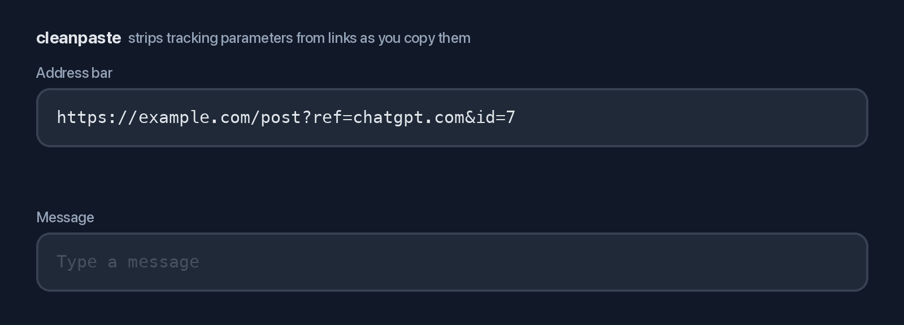

# cleanpaste

[](#install)
[](https://github.com/filip-pilar/cleanpaste/releases/latest)
[](#install)
[](LICENSE)

**Copy a link, paste a clean one.** A tiny macOS background agent that strips tracking
parameters from URLs the moment you copy them.



<sub>An illustration of the effect, using URLs from the test cases.</sub>

## Install

With [Homebrew](https://brew.sh):

```bash
brew install filip-pilar/tap/cleanpaste && brew services start cleanpaste
```

Or without Homebrew:

```bash
curl -fsSL https://raw.githubusercontent.com/filip-pilar/cleanpaste/main/install.sh | sh
```

Works on macOS 12 or later, on Apple Silicon and Intel. macOS will show a "Background
Items Added" notification: that is cleanpaste starting at login.

| | Homebrew | curl |
|---|---|---|
| Update | `brew upgrade cleanpaste` (the running copy switches over within a minute) | run the same line again |
| Remove | `brew services stop cleanpaste && brew uninstall cleanpaste` | add `-s -- --uninstall` after `sh` |

Use one or the other. The curl installer refuses to run over a Homebrew install.

### Or have your agent do it

Paste this into Claude Code, Codex, Cursor or any coding agent on your Mac:

```text
Install cleanpaste on this Mac: https://github.com/filip-pilar/cleanpaste
It is a small login agent that strips tracking parameters from links when I copy them.

1. Read the README and install.sh so you know what gets installed.
2. If Homebrew is installed, run:
   brew install filip-pilar/tap/cleanpaste && brew services start cleanpaste
   Otherwise run the curl installer from the README.
3. Confirm it is running with: pgrep -lx cleanpaste
4. Tell me how to update and remove it.

Then ask me to copy a link with tracking parameters and paste it, to check it works.
```

## What it cleans

| You copy | You paste |
|---|---|
| `example.com/post?utm_source=newsletter&id=7` | `example.com/post?id=7` |
| `example.com/post?ref=chatgpt.com` | `example.com/post` |
| `youtu.be/dQw4w9WgXcQ?si=abcdef&t=42` | `youtu.be/dQw4w9WgXcQ?t=42` |
| `x.com/someone/status/123?a=AbCdEf` | `x.com/someone/status/123` |
| `amazon.com/Some-Product/dp/B08N5WRWNW/ref=sr_1_3?crid=1&qid=1&th=1` | `amazon.com/Some-Product/dp/B08N5WRWNW?th=1` |
| `google.com/search?q=mac+apps&sca_esv=…&ei=…&ved=…` (20 more) | `google.com/search?q=mac+apps` |
| `google.com/url?…&url=https://example.com/page` | `example.com/page` |

- **Known trackers, everywhere:** `utm_*`, `fbclid`, `gclid`, `msclkid`, `mc_eid` and
  many more.
- **Short or generic names, only where they track:** `si` on YouTube and Spotify; `s`, `t`
  and `a` on X. The same names on other sites are left alone.
- **Referrer tags:** `?ref=chatgpt.com` goes, `?ref=main` stays.

- **Redirect wrappers are unwrapped:** Google, Facebook, Instagram, YouTube and LinkedIn
  outbound links become the real destination.
- **Links that need their parameters are never touched:** unsubscribe links, Firebase
  tester invites, Proofpoint-protected links and a few file-transfer sites.

The complete list is one file: [Sources/Rules.swift](Sources/Rules.swift). It is our own,
informed by the ClearURLs, AdGuard and Firefox tracker lists.

## Footprint

- Native Swift, about 290 KB for both Apple Silicon and Intel, no dependencies.
- Around 0.02 to 0.03% of one CPU core while you use the Mac, less when you are away.
- About 3 MB of memory.
- No network access, no logging, nothing written to disk.

## Limits

- **There is a short delay.** A copy is cleaned about 0.1 to 0.25 seconds after you make
  it; paste faster and you get the original. macOS has no clipboard-change event, so
  cleanpaste has to poll.
- **Only a lone URL is rewritten.** Text that merely contains a link is left alone, and a
  cleaned link becomes plain text.
- **It works from a list.** A tracker it has never seen stays in.
- **Short links are not resolved.** `t.co` or `bit.ly` would need network requests.
- **Password-manager copies are never read.**

## Missed a tracker?

Give your agent the URL:

```text
Clone https://github.com/filip-pilar/cleanpaste. This copied URL kept its tracking
parameters: <paste URL>
Follow AGENTS.md to add a rule for it, run ./test.sh, and try it on this Mac as
AGENTS.md describes. Then open a pull request.
```

The repo is laid out for this: rules are data in one file, test cases are data in another,
and [AGENTS.md](AGENTS.md) is the procedure. Building from source needs the Xcode command
line tools (`xcode-select --install`).

## Licence

MIT. See [LICENSE](LICENSE).
